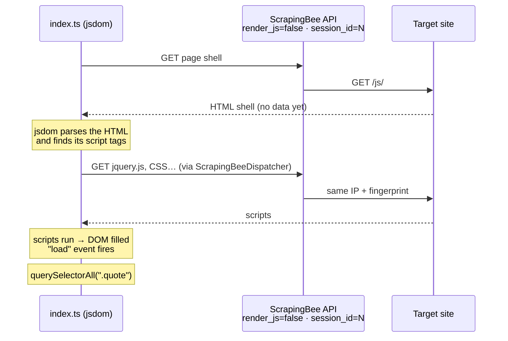

# Web hydration with ScrapingBee + jsdom

Scrape JavaScript-rendered pages **without launching a browser** — on your side
or on ScrapingBee's.

Most "dynamic" pages don't need a rendering engine to give up their data. They
need a **JavaScript engine**: the server sends an HTML shell, the page's scripts
run, fetch or build the content, and write it into the DOM. That step is called
*hydration*. You can run it yourself on a lightweight DOM implementation
([jsdom](https://github.com/jsdom/jsdom)) instead of booting a headless browser.

This repo shows how to do that with [ScrapingBee](https://www.scrapingbee.com)
as the network layer:

- **ScrapingBee fetches** every request (proxies, headers, fingerprint) with
  `render_js=false`, so it doesn't start a browser either.
- **jsdom runs the page's JavaScript locally** and builds the final DOM.
- **`session_id`** keeps the page shell *and* every follow-up request the page
  fires while loading on the same IP and TLS fingerprint.

The example target is [quotes.toscrape.com/js/](https://quotes.toscrape.com/js/),
a practice site whose quotes only appear after JavaScript runs. A plain `GET`
returns no quotes at all.

## Quick start

Requirements: **Node.js 22.18+** (it runs the `.ts` files directly, no build
step) and a [ScrapingBee API key](https://www.scrapingbee.com).

```bash
npm install
SCRAPINGBEE_API_KEY=your_api_key npm start
```

Expected output:

```
session_id=145404 · render_js=false · 10 quotes
{
  "quotes": [
    {
      "author": "Steve Martin",
      "quote": "“A day without sunshine is like, you know, night.”"
    },
    ...
```

## How it works



The code is two files.

### `index.ts` — fetch, hydrate, extract

1. **Fetch the shell** through the ScrapingBee HTML API with `render_js=false`
   and a random `session_id`.
2. **Hydrate** it with jsdom:
   - `runScripts: "dangerously"` executes the page's `<script>` tags;
   - `url` lets relative script URLs resolve;
   - `resources: { dispatcher }` makes jsdom download external scripts
     *through ScrapingBee* instead of connecting to the site directly.
3. **Wait for `load`**: external scripts load asynchronously, so the DOM is
   only complete once the window's `load` event fires.
4. **Extract** with ordinary DOM calls (`querySelectorAll`, `textContent`).

### `scrapingbee-dispatcher.ts` — jsdom's network layer

jsdom loads sub-resources with [undici](https://github.com/nodejs/undici), and
accepts a custom undici `Dispatcher`. `ScrapingBeeDispatcher` implements one:
for every request jsdom makes, it rewrites the URL into a ScrapingBee API call
with the **same `session_id`**, then streams the response back to jsdom.

Why this matters: if only the first request went through ScrapingBee, the
site would see the HTML requested from one IP and fingerprint, then the scripts
requested from yours a few milliseconds later. With the dispatcher, the whole
page load looks like one consistent visitor.

## Adapting it to your own target

- Change `DYNAMIC_PAGE_TARGET` and the selectors in the extraction step.
- If the site is hard to reach, enable premium proxies:
  `new ScrapingBeeDispatcher({ apiKey, sessionId, premiumProxy: true })`, and
  add `premium_proxy=true` to the shell request as well.
- If the page keeps loading data after `load` (late XHRs, timers), wait for
  the element you need instead of relying on `load` alone — for example, poll
  `document.querySelector(...)` until it returns something, with a timeout.
- **Before any of this, check the cheaper option**: many sites already ship the
  data as JSON inside a `<script>` tag of the raw HTML, or fetch it from a JSON
  endpoint you can call directly. If so, you don't need to run any JavaScript.

## Cost

Each request made with `render_js=false` costs 1 ScrapingBee credit (instead of
5 with JavaScript rendering). A page costs **one credit per request it makes**:
here, the shell plus the files jsdom loads (scripts, stylesheets). See
[ScrapingBee's documentation](https://www.scrapingbee.com/documentation/) for
current pricing and parameters.

## Limits

Hydration on jsdom is a DOM and a JavaScript engine, not a browser. It works
well for:

- pages that fetch JSON and render it into the DOM;
- client-side templating, "load more" content;
- high-volume scraping, where memory per page decides how many pages you can
  run in parallel.

It struggles with:

- frameworks that rely on browser APIs jsdom doesn't implement;
- anything that needs actual rendering: canvas, WebGL, layout —
  `getBoundingClientRect()` returns zeros, and there is no notion of visibility
  or scroll position;
- anti-bot scripts that probe for a real browser.

For those pages, use ScrapingBee with JavaScript rendering on (the default)
instead.

**Runtime:** use Node.js. Under Bun, jsdom's script sandbox currently fails
(`Proxy not allowed in the global prototype chain`) and the page never hydrates.

## Security note

`runScripts: "dangerously"` runs the target site's JavaScript inside your Node
process. jsdom is **not a security sandbox**: only point this at sites you
trust, and don't run it with credentials or secrets the page could reach.
